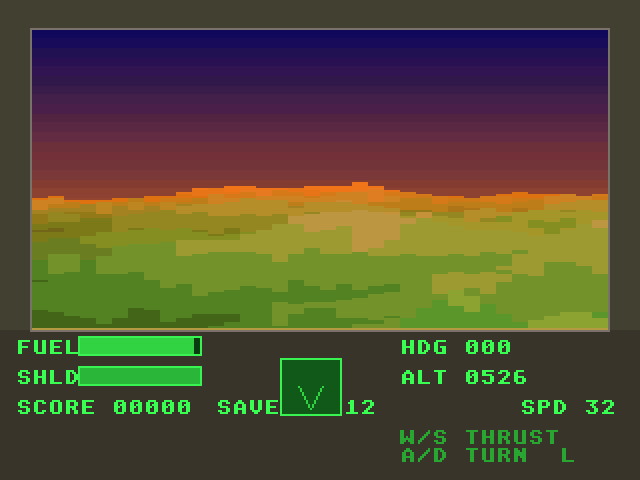

# atari_st_games

Atari ST / STE / Falcon030 ports of the games in
[geekychris/amiga_games](https://github.com/geekychris/amiga_games). The Amiga
versions are the originals; these ports keep their game and drawing code and
run it on small Atari layers that emulate the Amiga graphics API, Paula
sound and the AmigaDOS calls they need.

MIT licensed, same as the originals (see [LICENSE](LICENSE)).

| Game | Machine | |
|---|---|---|
| [Uranus Lander](uranus_lander) | ST | land on the pads of Uranus, with an autopilot |
| [Nova Defense](nova_defense) | ST | invaders, with a bot |
| [Frank the Frog](frank_the_frog) | ST | Frogger-style road and river crossing |
| [Rock Blaster](rock_blaster) | STE | vector rock shooter |
| [Orbital Patrol](orbital_patrol) | STE | Defender-style, MOD music |
| [Jump Quest](jump_quest) | STE | platformer |
| [StakAttack](stakattack) | STE | falling blocks, MOD music |
| [Dot Chase](dot_chase) | STE | maze dot-eater |
| [Lunar Rider](lunar_rider) | STE | Moon Patrol-style, blitter scrolling |
| [Pea Shooter Blast](pea_shooter_blast) | STE | side-scrolling tank, blitter scrolling |
| [Rescue on Fractalus](fractalus) | Falcon030 | Rescue on Fractalus-style voxel terrain |
| [Void Trader](void_trader) | Falcon030 | Elite-style 3D trading |
| [Sky Knights](sky_knights) | STE | Joust-style aerial combat |
| [Orb Hunter](orb_hunter) | STE | Metroid-style exploration platformer |
| [Ace Pilot](ace_pilot) | Falcon030 | 3D wireframe biplane dogfights |
| [Bullion Dash](bullion_dash) | STE | Lode Runner-style, with a level editor |
| [RJ's Birthday Bash](rj_birthday) | STE | party arcade for RJ Mical's 70th |
| [Spectral Keep](spectral_keep) | Falcon030 | isometric adventure (Knight Lore style) |
| [Rolling Steel](rolling_steel) | Falcon + 68060 (CT60) | isometric marble racer |
| [Planet Chomp](planet_chomp) | Falcon + 68060 (CT60) | Pac-Man on a sphere |

## Screenshots

<table>
<tr>
<td align="center" width="25%"><a href="uranus_lander"></a><br>Uranus Lander<br><sub>ST</sub></td>
<td align="center" width="25%"><a href="nova_defense"></a><br>Nova Defense<br><sub>ST</sub></td>
<td align="center" width="25%"><a href="frank_the_frog"></a><br>Frank the Frog<br><sub>ST</sub></td>
<td align="center" width="25%"><a href="rock_blaster"></a><br>Rock Blaster<br><sub>STE</sub></td>
</tr>
<tr>
<td align="center" width="25%"><a href="orbital_patrol"></a><br>Orbital Patrol<br><sub>STE</sub></td>
<td align="center" width="25%"><a href="jump_quest"></a><br>Jump Quest<br><sub>STE</sub></td>
<td align="center" width="25%"><a href="stakattack"></a><br>StakAttack<br><sub>STE</sub></td>
<td align="center" width="25%"><a href="dot_chase"></a><br>Dot Chase<br><sub>STE</sub></td>
</tr>
<tr>
<td align="center" width="25%"><a href="lunar_rider"></a><br>Lunar Rider<br><sub>STE</sub></td>
<td align="center" width="25%"><a href="pea_shooter_blast"></a><br>Pea Shooter Blast<br><sub>STE</sub></td>
<td align="center" width="25%"><a href="fractalus"></a><br>Rescue on Fractalus<br><sub>Falcon030</sub></td>
<td align="center" width="25%"><a href="void_trader"></a><br>Void Trader<br><sub>Falcon030</sub></td>
</tr>
<tr>
<td align="center" width="25%"><a href="sky_knights"></a><br>Sky Knights<br><sub>STE</sub></td>
<td align="center" width="25%"><a href="orb_hunter"></a><br>Orb Hunter<br><sub>STE</sub></td>
<td align="center" width="25%"><a href="ace_pilot"></a><br>Ace Pilot<br><sub>Falcon030</sub></td>
<td align="center" width="25%"><a href="bullion_dash"></a><br>Bullion Dash<br><sub>STE</sub></td>
</tr>
<tr>
<td align="center" width="25%"><a href="rj_birthday"></a><br>RJ's Birthday Bash<br><sub>STE</sub></td>
<td align="center" width="25%"><a href="spectral_keep"></a><br>Spectral Keep<br><sub>Falcon030</sub></td>
<td align="center" width="25%"><a href="rolling_steel"></a><br>Rolling Steel<br><sub>Falcon + 68060 (CT60)</sub></td>
<td align="center" width="25%"><a href="planet_chomp"></a><br>Planet Chomp<br><sub>Falcon + 68060 (CT60)</sub></td>
</tr>
</table>

Captured in Hatari through the agent API (`/screen`, 2x). Each game's README
has more, plus its controls and what the port changed.

Also here:

- [st_port](st_port) and [falcon_port](falcon_port): the port layers (Amiga
  header shims, graphics on ST bitplanes and Falcon 16-bit chunky, Paula
  emulation on STE DMA sound, a C ProTracker player, IKBD input, NatFeats
  logging).
- [falcon_3do](falcon_3do): the layer for the 3DO-derived games (Spectral
  Keep, Rolling Steel, Planet Chomp): their Amiga machine layer on the
  Falcon's true colour screen.
- [st_launcher](st_launcher): an Atari-side menu that puts every port on one
  C: drive.
- [games.ini](games.ini): the game list used by both launchers.
- [gemdemo](gemdemo) and [interact](interact): GEM and agent-API demos.

## Building

You need the m68k-atari-mint cross compiler (GCC 14 `m68k-atari-mintelf-`):

```sh
make -C rock_blaster                       # -> rock_blaster/build/ROCK.PRG
make -C rock_blaster CROSS=/path/to/m68k-atari-mintelf-
```

## Running

Running, the bots/autopilots and the test scripts use the Hatari emulator and
agent tooling from [geekychris/hatari_augmented](https://github.com/geekychris/hatari_augmented)
(which also provides EmuTOS images and a script to fetch the cross compiler).
Check it out next to this repo, or point `HATARI_DIR` at it:

```sh
git clone https://github.com/geekychris/hatari_augmented ../hatari_augmented
../hatari_augmented/tools/agent/fetch-cross-mint.sh     # once: cross compiler
make -C rock_blaster run                                # Hatari + agent API, autostarts the game
HATARI_DIR=~/src/hatari_augmented make -C fractalus run
python3 ../hatari_augmented/tools/games/launcher.py --ini games.ini   # host-side launcher
```

## History

These ports were developed in `hatari_augmented/examples/` and moved here with
their git history. The same games also run on the 3DO through
[geekychris/3do-dev](https://github.com/geekychris/3do-dev).
