<p align="center">
  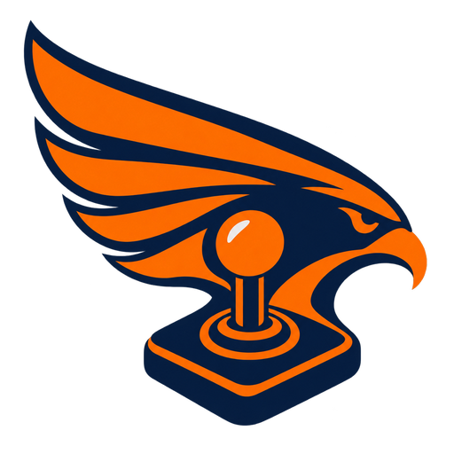
</p>

# atari_st_games

Atari ST / STE / Falcon030 ports of the games in
[geekychris/amiga_games](https://github.com/geekychris/amiga_games). The Amiga
versions are the originals; these ports keep their game and drawing code and
run it on small Atari layers that emulate the Amiga graphics API, Paula
sound and the AmigaDOS calls they need.

MIT licensed, same as the originals (see [LICENSE](LICENSE)).

| Game | Machine | |
|---|---|---|
| [Uranus Lander](uranus_lander) | ST | land on the pads of Uranus, with an autopilot |
| [Nova Defense](nova_defense) | ST | fixed-screen alien shooter, with a bot |
| [Frank the Frog](frank_the_frog) | ST | road and river crossing |
| [Rock Blaster](rock_blaster) | STE | vector rock shooter |
| [Orbital Patrol](orbital_patrol) | STE | side-scrolling planet defence, MOD music |
| [Jump Quest](jump_quest) | STE | platformer |
| [StakAttack](stakattack) | STE | falling gems, MOD music |
| [Dot Chase](dot_chase) | STE | ladybug and spiders in a hedge maze |
| [Lunar Rider](lunar_rider) | STE | moon buggy ride, blitter scrolling |
| [Pea Shooter Blast](pea_shooter_blast) | STE | side-scrolling tank, blitter scrolling |
| [Canyon Rescue](canyon_rescue) | Falcon030 | pilot rescue over voxel terrain |
| [Void Trader](void_trader) | Falcon030 | 3D space trading and combat |
| [Sky Knights](sky_knights) | STE | aerial jousting |
| [Orb Hunter](orb_hunter) | STE | cavern exploration platformer |
| [Ace Pilot](ace_pilot) | Falcon030 | 3D wireframe biplane dogfights |
| [Bullion Dash](bullion_dash) | STE | gold-digging puzzle platformer, with a level editor |
| [RJ's Birthday Bash](rj_birthday) | STE | party arcade for RJ Mical's 70th |
| [Spectral Keep](spectral_keep) | Falcon030 | isometric flip-screen adventure |
| [Rolling Steel](rolling_steel) | Falcon + 68060 (CT60) | isometric marble racer |
| [Planet Chomp](planet_chomp) | Falcon + 68060 (CT60) | maze chase on a sphere |
| [Emberkeep](emberkeep) | Falcon030 | cavern exploring by lantern light |
| [Warden Keep](warden_keep) | Falcon030 | isometric room: push barrels, grab jewels |
| [Miner Meteor](miner_meteor) | Falcon030 | single-screen platformer |
| [Block Breaker 3D](block_breaker_3d) | Falcon + 68060 (CT60) | breakout down a tunnel |
| [Marble Tilt](marble_tilt) | Falcon + 68060 (CT60) | tilting maze board |
| [Harbour Crane](harbour_crane) | Falcon + 68060 (CT60) | pendulum crane loading a rolling ship |
| [Tank Duel](tank_duel) | Falcon + 68060 (CT60) | tank fight in a walled arena |
| [Orbit Docking](orbit_docking) | Falcon + 68060 (CT60) | docking with a spinning station |
| [Stack Tower](stack_tower) | Falcon + 68060 (CT60) | falling blocks round a tower |
| [Ridge Runner](ridge_runner) | Falcon + 68060 (CT60) | hover-bike valley race |
| [Drone Courier](drone_courier) | Falcon + 68060 (CT60) | drone deliveries across a city |
| [Canyon Rail](canyon_rail) | Falcon + 68060 (CT60) | canyon rail shooter |
| [Lander 3D](lander_3d) | Falcon + 68060 (CT60) | lunar lander over 3D terrain |
| [Boing Pinball](boing_pinball) | Falcon + 68060 (CT60) | pinball, three tables |
| [ScAIry Fun](scairy_fun) | Falcon + 68060 (CT60) | a self-driving car game |

## Screenshots

<table>
<tr>
<td align="center" width="25%"><a href="uranus_lander">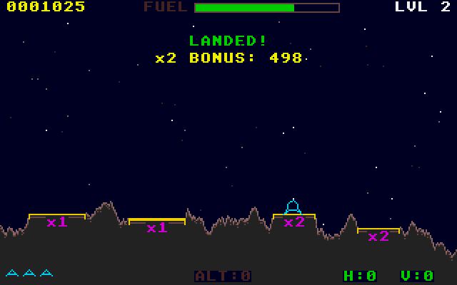</a><br>Uranus Lander<br><sub>ST</sub></td>
<td align="center" width="25%"><a href="nova_defense">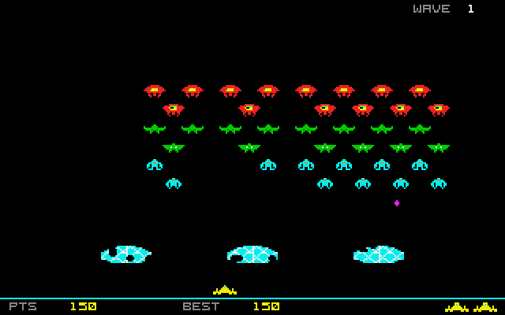</a><br>Nova Defense<br><sub>ST</sub></td>
<td align="center" width="25%"><a href="frank_the_frog">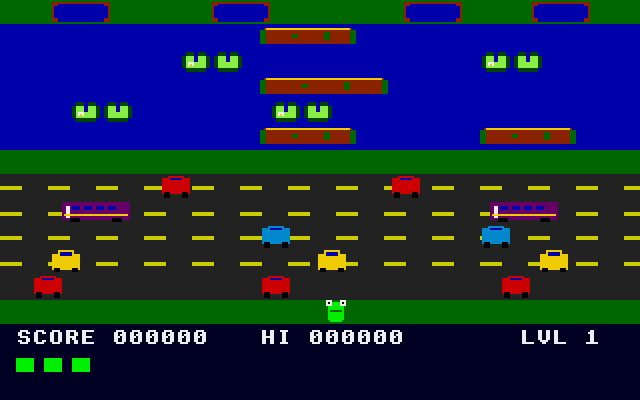</a><br>Frank the Frog<br><sub>ST</sub></td>
<td align="center" width="25%"><a href="rock_blaster">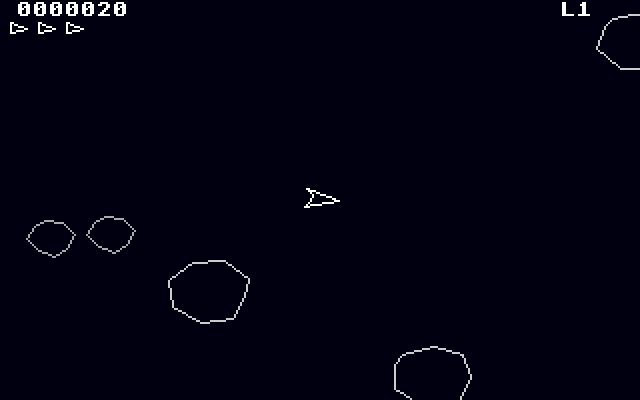</a><br>Rock Blaster<br><sub>STE</sub></td>
</tr>
<tr>
<td align="center" width="25%"><a href="orbital_patrol">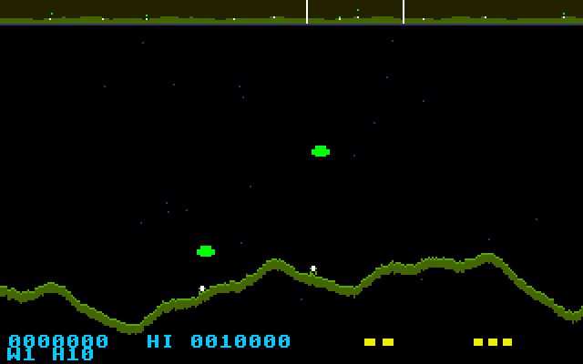</a><br>Orbital Patrol<br><sub>STE</sub></td>
<td align="center" width="25%"><a href="jump_quest">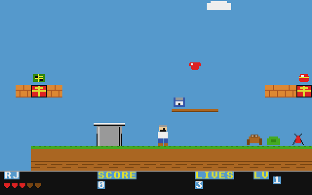</a><br>Jump Quest<br><sub>STE</sub></td>
<td align="center" width="25%"><a href="stakattack">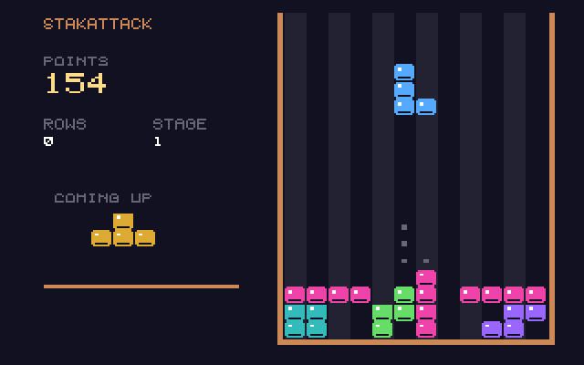</a><br>StakAttack<br><sub>STE</sub></td>
<td align="center" width="25%"><a href="dot_chase">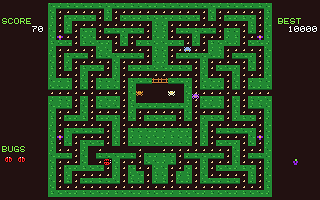</a><br>Dot Chase<br><sub>STE</sub></td>
</tr>
<tr>
<td align="center" width="25%"><a href="lunar_rider">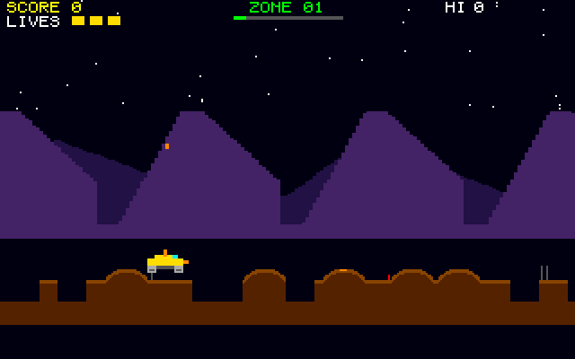</a><br>Lunar Rider<br><sub>STE</sub></td>
<td align="center" width="25%"><a href="pea_shooter_blast">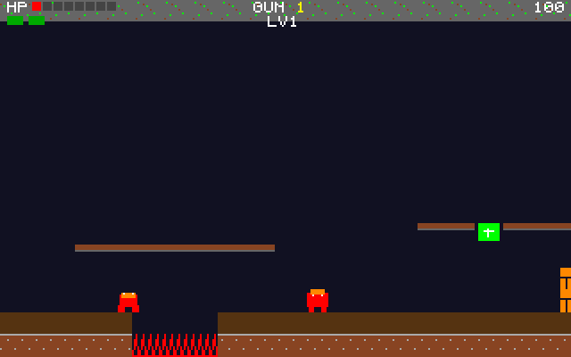</a><br>Pea Shooter Blast<br><sub>STE</sub></td>
<td align="center" width="25%"><a href="canyon_rescue">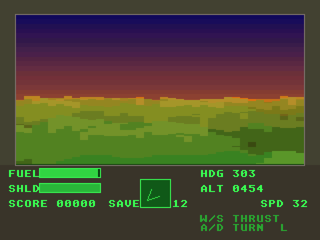</a><br>Canyon Rescue<br><sub>Falcon030</sub></td>
<td align="center" width="25%"><a href="void_trader">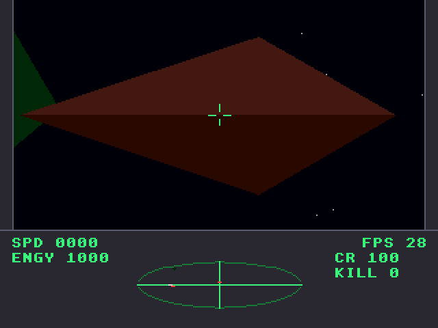</a><br>Void Trader<br><sub>Falcon030</sub></td>
</tr>
<tr>
<td align="center" width="25%"><a href="sky_knights">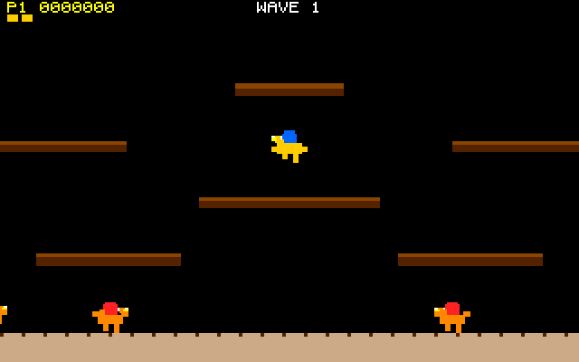</a><br>Sky Knights<br><sub>STE</sub></td>
<td align="center" width="25%"><a href="orb_hunter">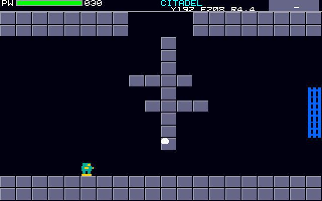</a><br>Orb Hunter<br><sub>STE</sub></td>
<td align="center" width="25%"><a href="ace_pilot">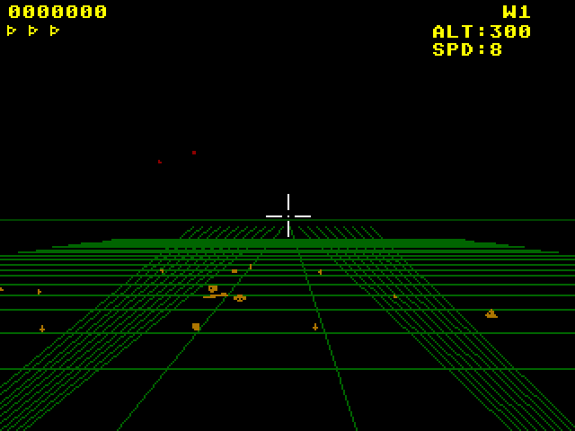</a><br>Ace Pilot<br><sub>Falcon030</sub></td>
<td align="center" width="25%"><a href="bullion_dash">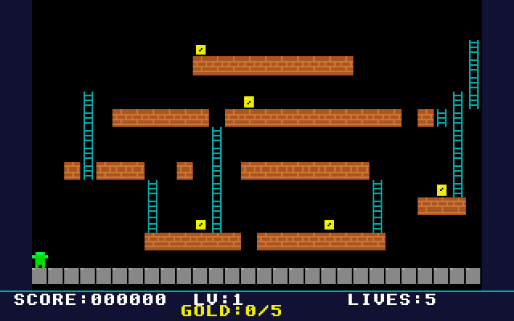</a><br>Bullion Dash<br><sub>STE</sub></td>
</tr>
<tr>
<td align="center" width="25%"><a href="rj_birthday">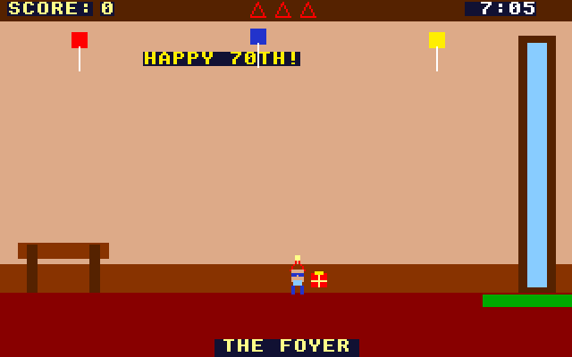</a><br>RJ's Birthday Bash<br><sub>STE</sub></td>
<td align="center" width="25%"><a href="spectral_keep">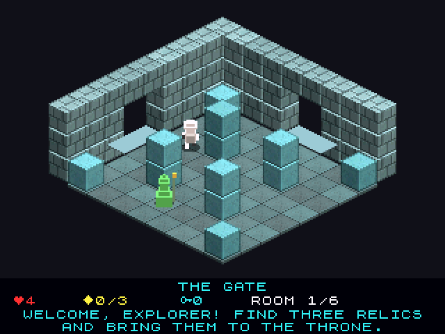</a><br>Spectral Keep<br><sub>Falcon030</sub></td>
<td align="center" width="25%"><a href="rolling_steel">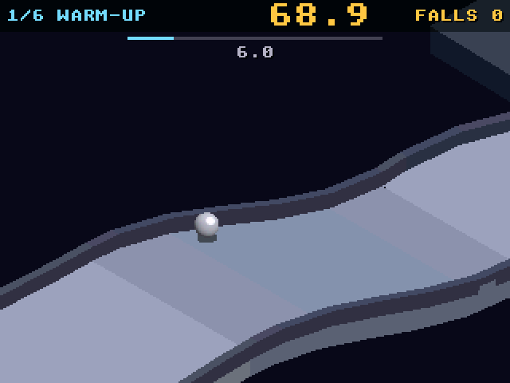</a><br>Rolling Steel<br><sub>Falcon + 68060 (CT60)</sub></td>
<td align="center" width="25%"><a href="planet_chomp">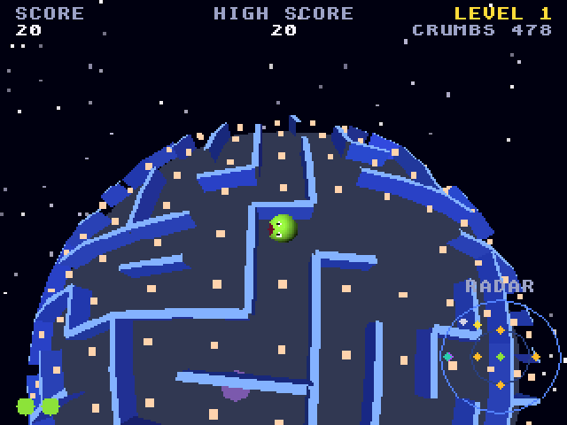</a><br>Planet Chomp<br><sub>Falcon + 68060 (CT60)</sub></td>
</tr>
<tr>
<td align="center" width="25%"><a href="emberkeep"></a><br>Emberkeep<br><sub>Falcon030</sub></td>
<td align="center" width="25%"><a href="warden_keep">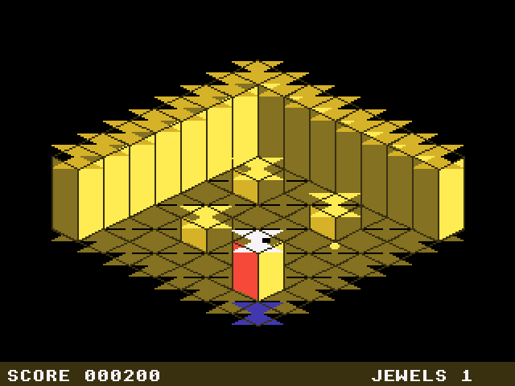</a><br>Warden Keep<br><sub>Falcon030</sub></td>
<td align="center" width="25%"><a href="miner_meteor">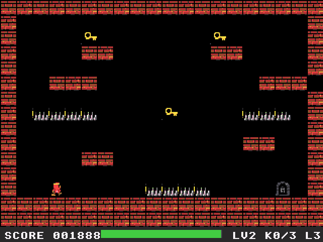</a><br>Miner Meteor<br><sub>Falcon030</sub></td>
<td></td>
</tr>
<tr>
<td align="center" width="25%"><a href="block_breaker_3d">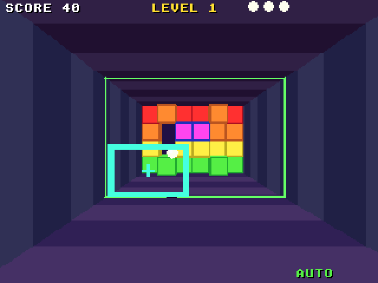</a><br>Block Breaker 3D<br><sub>Falcon + 68060 (CT60)</sub></td>
<td align="center" width="25%"><a href="marble_tilt">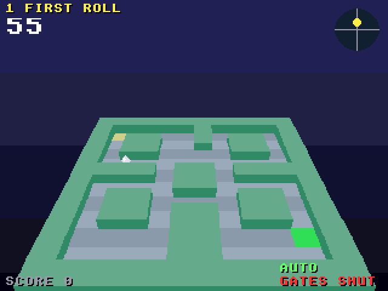</a><br>Marble Tilt<br><sub>Falcon + 68060 (CT60)</sub></td>
<td align="center" width="25%"><a href="harbour_crane">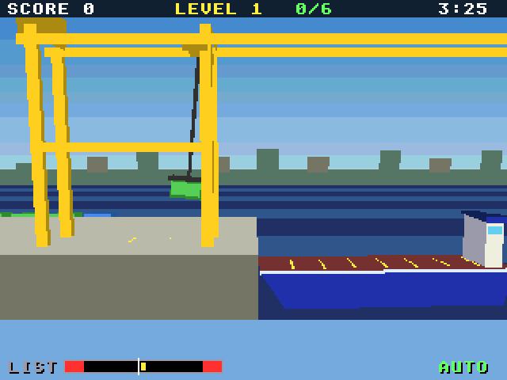</a><br>Harbour Crane<br><sub>Falcon + 68060 (CT60)</sub></td>
<td align="center" width="25%"><a href="tank_duel">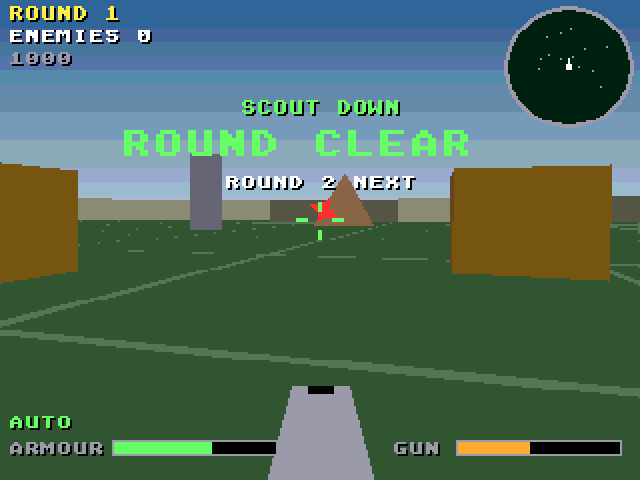</a><br>Tank Duel<br><sub>Falcon + 68060 (CT60)</sub></td>
</tr>
<tr>
<td align="center" width="25%"><a href="orbit_docking">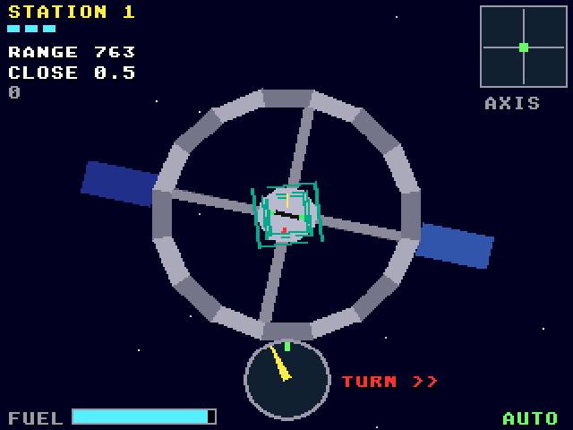</a><br>Orbit Docking<br><sub>Falcon + 68060 (CT60)</sub></td>
<td align="center" width="25%"><a href="stack_tower">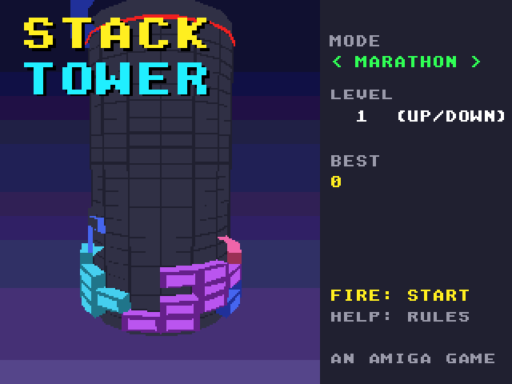</a><br>Stack Tower<br><sub>Falcon + 68060 (CT60)</sub></td>
<td align="center" width="25%"><a href="ridge_runner">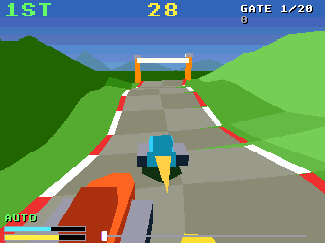</a><br>Ridge Runner<br><sub>Falcon + 68060 (CT60)</sub></td>
<td align="center" width="25%"><a href="drone_courier">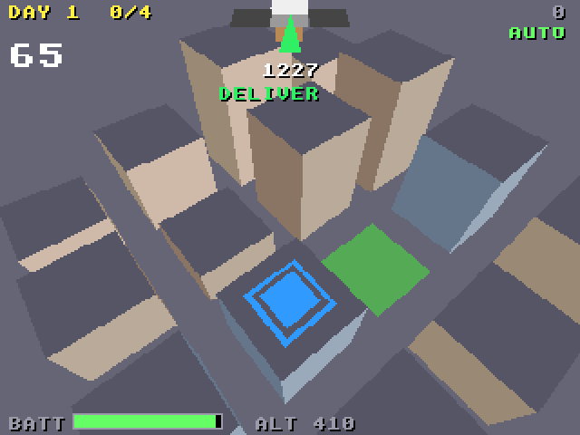</a><br>Drone Courier<br><sub>Falcon + 68060 (CT60)</sub></td>
</tr>
<tr>
<td align="center" width="25%"><a href="canyon_rail">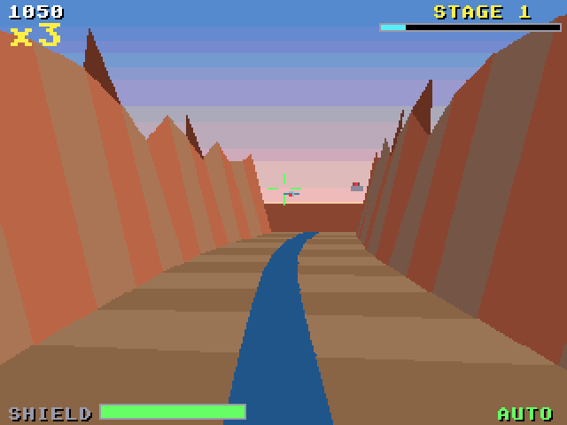</a><br>Canyon Rail<br><sub>Falcon + 68060 (CT60)</sub></td>
<td align="center" width="25%"><a href="lander_3d">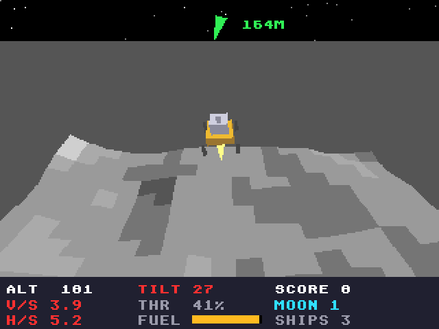</a><br>Lander 3D<br><sub>Falcon + 68060 (CT60)</sub></td>
<td align="center" width="25%"><a href="boing_pinball">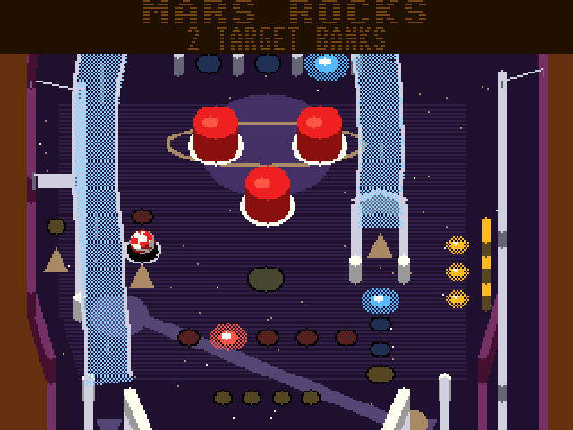</a><br>Boing Pinball<br><sub>Falcon + 68060 (CT60)</sub></td>
<td align="center" width="25%"><a href="scairy_fun">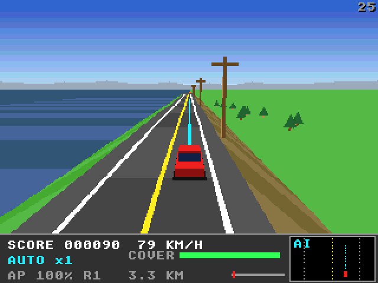</a><br>ScAIry Fun<br><sub>Falcon + 68060 (CT60)</sub></td>
</tr>
</table>

Captured in Hatari through the agent API (`/screen`, 2x). Each game's README
has more, plus its controls and what the port changed.

Also here:

- [st_port](st_port) and [falcon_port](falcon_port): the port layers (Amiga
  header shims, graphics on ST bitplanes and Falcon 16-bit chunky, Paula
  emulation on STE DMA sound, a C ProTracker player, IKBD input, NatFeats
  logging).
- [a3d_falcon](a3d_falcon): the Falcon platform layer for the amiga3d engine
  games (Block Breaker 3D to ScAIry Fun): 256-colour interleaved planes, an
  assembly polygon fill, the bridge calls through a mailbox the agent API
  reaches, and test, trace and end-to-end tools.
- [falcon_3do](falcon_3do): the layer for the 3DO-derived games (Spectral
  Keep, Rolling Steel, Planet Chomp): their Amiga machine layer on the
  Falcon's true colour screen.
- [st_launcher](st_launcher): an Atari-side menu that puts every port on one
  C: drive.
- [games.ini](games.ini): the game list used by both launchers.
- [gemdemo](gemdemo) and [interact](interact): GEM and agent-API demos.

## Building

You need the m68k-atari-mint cross compiler (GCC 14 `m68k-atari-mintelf-`):

```sh
make -C rock_blaster                       # -> rock_blaster/build/ROCK.PRG
make -C rock_blaster CROSS=/path/to/m68k-atari-mintelf-
```

## Running

Running, the bots/autopilots and the test scripts use the Hatari emulator and
agent tooling from [geekychris/hatari_augmented](https://github.com/geekychris/hatari_augmented)
(which also provides EmuTOS images and a script to fetch the cross compiler).
Check it out next to this repo, or point `HATARI_DIR` at it:

```sh
git clone https://github.com/geekychris/hatari_augmented ../hatari_augmented
../hatari_augmented/tools/agent/fetch-cross-mint.sh     # once: cross compiler (x86-64: Rosetta on Apple Silicon, qemu on arm64 Linux;
                                                        #   or build-cross-mint.sh for a native one)
make -C rock_blaster run                                # Hatari + agent API, autostarts the game
HATARI_DIR=~/src/hatari_augmented make -C canyon_rescue run
python3 ../hatari_augmented/tools/games/launcher.py --ini games.ini   # host-side launcher
```

## History

These ports were developed in `hatari_augmented/examples/` and moved here with
their git history. The same games also run on the 3DO through
[geekychris/3do-dev](https://github.com/geekychris/3do-dev).
