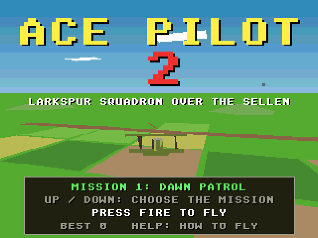
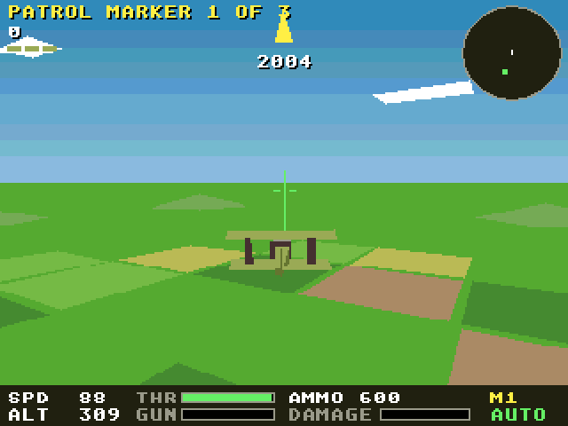
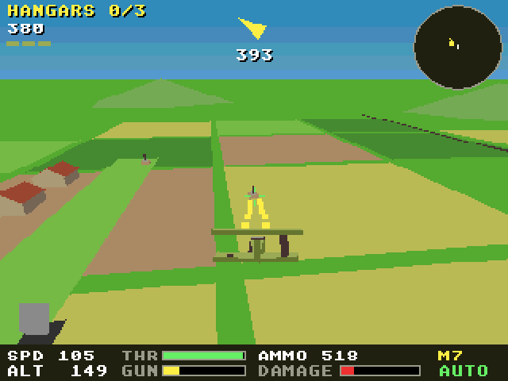

# Ace Pilot 2 (Falcon030)

The Atari Falcon030 port of [Ace Pilot 2](https://github.com/geekychris/amiga_games/tree/main/ace_pilot2), an Amiga game on
the shared amiga3d engine. A biplane war in 3D: you fly a Swallow scout
of Larkspur Squadron over the trenches and the river Sellen, in eight
missions (a patrol, balloons, an escort, a train, bombers, supply dumps,
an aerodrome raid and the enemy's ace), from behind or from the cockpit.
It is the 3D sequel to [Ace Pilot](../ace_pilot), the wireframe game.

It runs on the Falcon through [`../a3d_falcon`](../a3d_falcon/README.md),
the engine's Falcon platform layer: the game's own sources are copied from
amiga_games and built for the Falcon as they are.





## On the Falcon

- **Machine:** a Falcon030 with a 68060 accelerator (CT60 class; Hatari
  `--cpulevel 6 --cpuclock 32 --addr24 off --ttram 64`, as `../games.ini`
  starts it) runs it at the Amiga versions' 25 frames a second.
  On a stock 16 MHz Falcon it draws 6.7-7.0 frames a second on patrol and
  4-8 in the aerodrome raid; the game keeps time (its simulation runs at
  25 steps a second whatever the frame rate), so it plays, but jerkily.
  Full speed needs the accelerator.
  The same program runs on both: it is 68020-68060 code, and the
  fixed-point multiply and divide use the 68030's 64-bit instructions
  when the CPU has them.
- **Screen:** 320 x 240 in 256 colours (VGA): the game's 32 pens plus 16
  for the sky gradient the Amiga made with the copper. The game draws on
  320 x 256 as on the Amiga; one row in 16 is dropped (text keeps all its
  strokes). The view reaches 1600 units, as on the classic Amiga.
- **Camera:** the engine's precise camera (`cam_place` / `cam_for`), so
  the chase view glides rather than stepping a unit at a time.
- **Sound:** the effects on the Falcon's DMA sound through the
  repository's Paula emulation and C ProTracker player (`../st_port`).
  No data files: the effects are synthesised at start-up and there is no
  music, so the program is all you need.
- **Changes to the game's code:**
  None: the game's sources are the amiga_games originals, unchanged.

## Controls

| | |
|---|---|
| Left / right (joystick) | bank |
| Up / down (joystick) | nose down / nose up (I inverts) |
| Space / fire | guns |
| A / Z | throttle up / down |
| V (or C) | chase view / cockpit |
| I | invert up and down |
| P | pause |
| B | autopilot on / off |
| Help / H | how to fly, the controls |
| Return / F1 | start |
| Esc | back to the title, or quit from it |

On the title, up and down choose the mission to start from. On the ST
keyboard the Amiga's keys map to the same places
(`../a3d_falcon/falcon_sys.c`).

## Building and running

```sh
make CROSS=~/computers/atari-cc/opt/cross-mint/bin/m68k-atari-mintelf-
                             # build/ACEPILT2.PRG
make run                     # Hatari (agent API), build/ as C:, autostart
make run HATARI_OPTS="--cpulevel 6 --cpuclock 32 --addr24 off --ttram 64"   # with a 68060
make test                    # the tests on the Falcon in Hatari (build/obj/test/AP2TEST.PRG)
make host-test               # the same tests built for this machine
```

`../a3d_falcon/tools/a3d_agent.py` drives a running game through the
agent API (`cmd 'hook start 7'`, `cmd 'hook autoplay on'`, `cmd vars`,
`shot`, `key`, `perf`), and `a3d_e2e.py ace_pilot2 --shots` is the
end-to-end check below.

## Tested

- `make test`: 65 passed, 0 failed, on the 68030 and on the 68060 (the
  same as `make host-test`), including the autopilot campaign's state
  hash 0x2B867448 over 20,000 ticks (tests/vectors.h, as amiga_games).
- `a3d_e2e.py`: in Hatari, every key above reaches the game (the IKBD,
  the ST to Amiga key map and the game's own), the start key leaves the
  title and Esc returns to it, and the autopilot flies (`docs/play.png`
  on a stock Falcon, `docs/play_060.png` on a 68060).
- Frames a second with the autopilot flying: 6.7-7.0 on patrol (mission
  1) and 4-8 in the aerodrome raid (mission 7) on a stock 16 MHz
  Falcon030; 25 (the cap) with a 68060 at 32 MHz.
