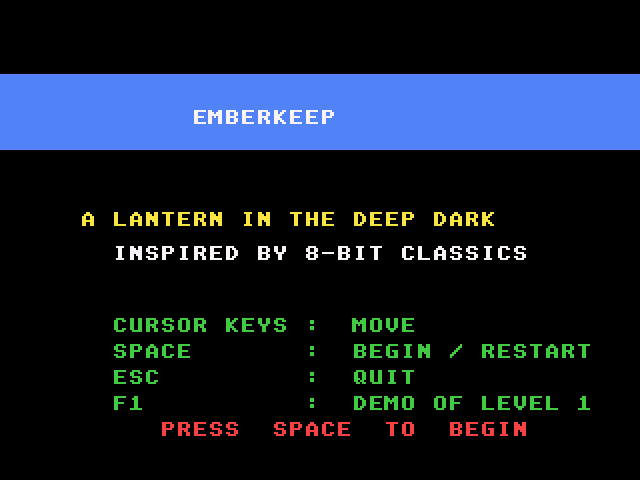
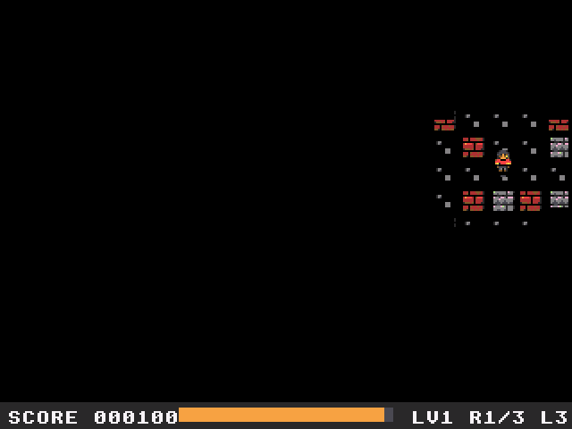
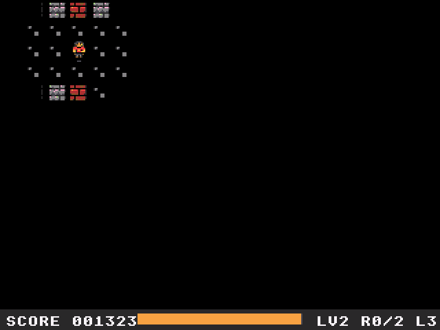
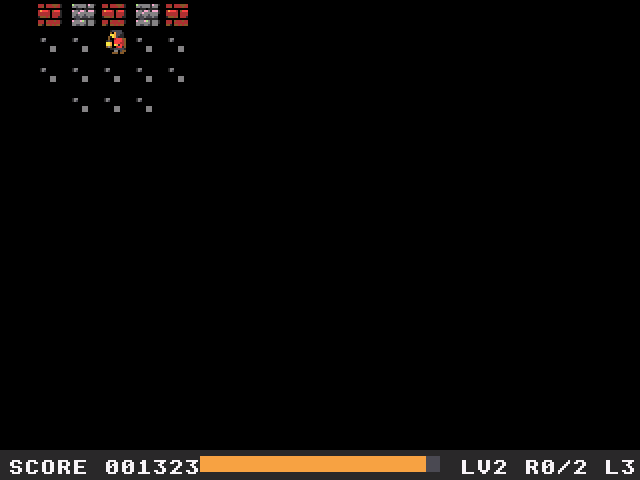

# Emberkeep: Atari Falcon030 port

Port of Emberkeep, the top-down lantern-in-the-dark cavern explorer from
[geekychris/amiga_games](https://github.com/geekychris/amiga_games)
(`emberkeep/`, commit in `.upstream-commit`). Collect the runes to open the
exit portal and keep your lantern burning with oil flasks: it only lights a
small square around you, and the light shrinks as the oil runs out. Four
chambers. On the Amiga it is an AGA game on a 256-colour screen (it uses 16
of the colours); the port runs on the Falcon layer in
[../falcon_port](../falcon_port) (16-bit true colour).

## Screenshots

<table><tr>
<td align="center"><br>Title</td>
<td align="center"><br>The recorded run in chamber 1</td>
</tr><tr>
<td align="center"><br>Chamber 2, the Oil Cellar</td>
<td align="center"><br>Exploring</td>
</tr></table>

Captured through the agent API (`/screen`, 2x) by `emberkeep_test.py`.

```sh
make CROSS=~/computers/atari-cc/opt/cross-mint/bin/m68k-atari-mintelf-
make run CROSS=...      # Falcon030, 14 MB, VGA, EmuTOS 1024k, autostart
```

Controls, as on the Amiga:
- Cursor keys, WASD or joystick: walk.
- Space or fire: start, and back to the title from the end screen.
- Esc: quit.
- F1 on the title (port addition): a recorded run through chamber 1, which
  hands over to you at chamber 2.

The Amiga version is silent (its sound functions are stubs), and so is this one.

## What changed

| | |
|---|---|
| `game.cpp`, `game.h`, `levels.h`, `audio.cpp`, `audio.h`, `tilesheet_data.*`, `render.h` | **Unmodified.** |
| `levels.cpp` | One fix, see below. |
| `render.cpp` | `__MINT__` branches: the screen is fgfx's (320x240, triple buffered) instead of an AGA screen with two `ScreenBuffer`s, and tiles are written straight into it as RGB565 words instead of one `RectFill` per run of same-coloured pixels. The game keeps its 320x256 coordinates; Y is mapped to 240 lines (each 16-pixel tile loses one row). |
| `main_falcon.cpp` | Replaces `main.cpp` (kept as `main.cpp.amiga`): IKBD keys and joystick instead of IDCMP raw keys, the VBL counter instead of `WaitTOF`, NatFeats logging. |
| `demo.h` | The recorded run (port addition). |

Speed: each grid cell of each of the three screen buffers remembers what it
holds. Cells outside the light only need to be black and are filled once when
they go dark; the few cells the light touches are redrawn every frame, with
the sprites and the lantern mask clipped to them. The picture is the same as
drawing everything and masking it, as the Amiga does.

Timing: the Amiga runs one game tick per 50 Hz frame. The port runs the ticks
due at 50 Hz from the VBL counter (60 Hz on VGA, up to 4 per drawn frame), so
the game plays at the Amiga's speed whatever the frame rate.

Input: key presses shorter than a drawn frame are not lost (`ikbd_key_hit`),
as the Amiga's queued RAWKEY messages aren't.

### Fixes to the original

- **Chamber 1 could not be completed.** The rune at column 6, row 6 sits in a
  walled box with no way in (row 5 was `#..#............####`). The port opens
  two tiles of row 5 (`#..#............#..#`) so the box can be entered from
  the corridor above (`FIX_SEALED_RUNE` in the levels file; 0 gives the
  original layout). Found by a breadth-first search over the game's tick
  function; chambers 2-4 were fine.
- The title and end-screen captions are drawn in pen 0 over a coloured bar.
  With the Amiga's default JAM2 draw mode (background pen 0) they come out as
  black boxes; the port draws text in JAM1, so they can be read.

## Performance

On a 16 MHz Falcon030 (VGA): **50 fps** in the chambers (the game's full
speed), 30 fps on the title screen, which is cleared and redrawn every frame.

## Tests and agent hooks

`emberkeep_test.py` (with `make run` going, `HATARI_API` if not on :7777) resets
the emulator, starts the recorded run, checks that it clears chamber 1 and that
chamber 2 starts, walks around, checks the PERF lines and quits with Esc; the
screenshots above come from it. The game logs `EMBERKEEP SYMBOL state 0x...`
(the `GameState`), a `state=...` line on every change of mode, level, lives
or runes, `demo: start` / `demo: done`, and a PERF line every 100 frames.
