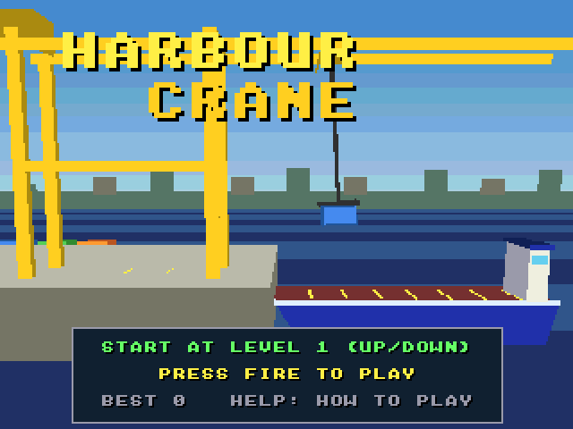

# Harbour Crane (Falcon030)

The Atari Falcon030 port of [Harbour Crane](https://github.com/geekychris/amiga_games/tree/main/harbour_crane), an Amiga game on
the shared amiga3d engine. A gantry crane loading a ship that rolls in the swell. The trolley runs along the gantry, the winch lets the hook up and down, and the load swings like a pendulum, pushed by the trolley's starts and stops and by the wind.

It runs on the Falcon through [`../a3d_falcon`](../a3d_falcon/README.md),
the engine's Falcon platform layer: the game's own sources are copied from
amiga_games and built for the Falcon as they are.




## On the Falcon

- **Machine:** a Falcon030 with a 68060 accelerator (CT60 class; Hatari
  `--cpulevel 6 --cpuclock 32 --addr24 off --ttram 64`, as `../games.ini`
  starts it) runs it at the Amiga versions' 25 frames a second.
  On a stock 16 MHz Falcon it draws 6.4-6.6 frames a second; the game keeps time (its simulation runs at 25 steps a second whatever the frame rate), so it plays, but jerkily. Full speed needs the accelerator.
  The same program runs on both: it is 68020-68060 code, and the
  fixed-point multiply and divide use the 68030's 64-bit instructions
  when the CPU has them.
- **Screen:** 320 x 240 in 256 colours (VGA): the game's 32 pens plus 16
  for the sky gradient the Amiga made with the copper. The game draws on
  320 x 256 as on the Amiga; one row in 16 is dropped (text keeps all its
  strokes).
- **Sound:** the effects on the Falcon's DMA sound through the
  repository's Paula emulation and C ProTracker player (`../st_port`).
  No data files: the effects are synthesised at start-up, so the program is all you need.
- **Changes to the game's code:**
  None: the game's sources are the amiga_games originals, unchanged.

## Controls

| | |
|---|---|
| Left / right (A / D, joystick) | move the trolley |
| Up / down (W / S, joystick) | winch in / out |
| Space / fire | grab / let go |
| P | pause |
| B | autopilot on / off |
| Help / H | the rules and controls |
| Esc | back to the title, or quit from it |

On the ST keyboard the Amiga's keys map to the same places (`../a3d_falcon/main_falcon.c`).

## Building and running

```sh
make CROSS=~/computers/atari-cc/opt/cross-mint/bin/m68k-atari-mintelf-
                             # build/HARBOUR.PRG
make run                     # Hatari (agent API), build/ as C:, autostart
make run HATARI_OPTS="--cpulevel 6 --cpuclock 32 --addr24 off --ttram 64"   # with a 68060
make test                    # the tests on the Falcon in Hatari (build/obj/test/HCTEST.PRG)
make host-test               # the same tests built for this machine
```

`../a3d_falcon/tools/a3d_agent.py` drives a running game through the
agent API (`cmd 'hook autoplay on'`, `cmd vars`, `shot`, `key`, `perf`),
and `a3d_e2e.py harbour_crane --shots` is the end-to-end check below.

## Tested

- `make test`: 51 passed, 0 failed, on the 68030 and on the
  68060 (the same as `make host-test`), including the autopilot run's state hash 0x6ADC57B8 (tests/vectors.h).
- `a3d_e2e.py`: in Hatari, every key above reaches the game (the IKBD,
  the ST to Amiga key map and the game's own), the start key leaves the
  title and Esc returns to it, and the autopilot plays (`docs/play.png` on a stock Falcon, `docs/play_060.png` on a 68060).
- Frames a second with the autopilot playing: 6.4-6.6 on a stock
  16 MHz Falcon030, 25 (the cap) with a 68060 at 32 MHz.
