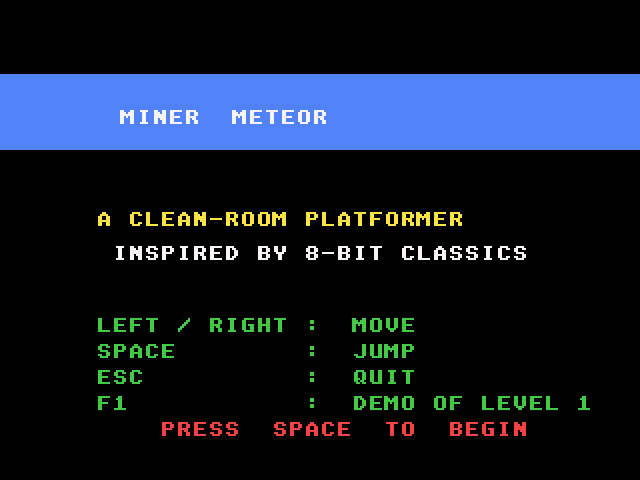
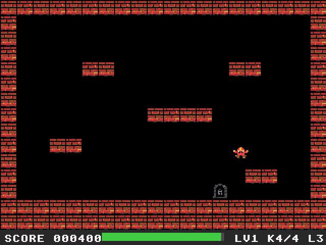
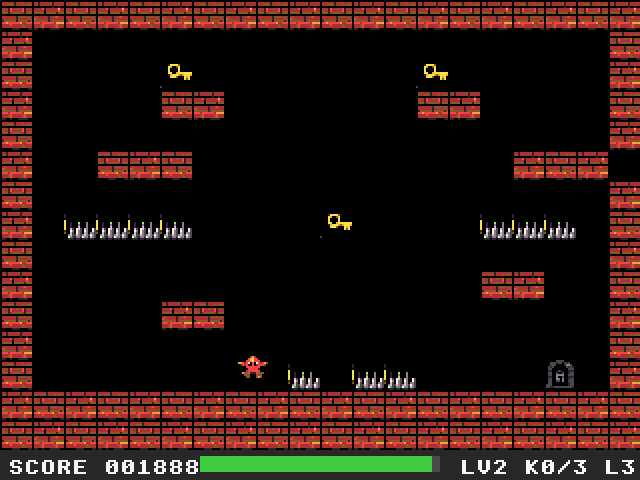

# Miner Meteor: Atari Falcon030 port

Port of Miner Meteor, the single-screen platformer from
[geekychris/amiga_games](https://github.com/geekychris/amiga_games)
(`miner_meteor/`, commit in `.upstream-commit`). Collect the keys to unlock
the exit before the air runs out, past spikes, conveyor belts, collapsing
floors and patrolling guardians. Six caverns. On the Amiga it is an AGA game
on a 256-colour screen (it uses 16 of the colours); the port runs on the
Falcon layer in [../falcon_port](../falcon_port) (16-bit true colour).

## Screenshots

<table><tr>
<td align="center"><br>Title</td>
<td align="center"><br>The recorded run in cavern 1</td>
</tr><tr>
<td align="center"><br>Cavern 2, Hazard Bay</td>
<td align="center"><br>Jumping</td>
</tr></table>

Captured through the agent API (`/screen`, 2x) by `miner_test.py`.

```sh
make CROSS=~/computers/atari-cc/opt/cross-mint/bin/m68k-atari-mintelf-
make run CROSS=...      # Falcon030, 14 MB, VGA, EmuTOS 1024k, autostart
```

Controls, as on the Amiga:
- Cursor left/right or A/D: walk.
- Space or cursor up: jump. Space also starts, and returns to the title from
  the end screen.
- Joystick: fire jumps and starts. The port also reads the stick's left and
  right (the Amiga version has them switched off).
- Esc: quit.
- F1 on the title (port addition): a recorded run through cavern 1, which
  hands over to you at cavern 2.

The Amiga version is silent (its sound functions are stubs that log
`sfx: ...` lines), and so is this one.

## What changed

| | |
|---|---|
| `game.cpp`, `levels.*`, `audio.*`, `tilesheet_data.*`, `render.h` | **Unmodified.** |
| `game.h` | One fix, see below. |
| `render.cpp` | `__MINT__` branches: the screen is fgfx's (320x240, triple buffered) instead of an AGA screen with two `ScreenBuffer`s, tiles are written straight into it as RGB565 words instead of one `RectFill` per run of same-coloured pixels, and only grid cells that changed (a key taken, the exit blinking, a floor collapsing) or that a sprite covered are redrawn, per screen buffer. The game keeps its 320x256 coordinates; Y is mapped to 240 lines (each 16-pixel tile loses one row). |
| `main_falcon.cpp` | Replaces `main.cpp` (kept as `main.cpp.amiga`): IKBD keys and joystick instead of IDCMP raw keys and the CIA fire button, the VBL counter instead of `WaitTOF`, NatFeats logging. |
| `demo.h` | The recorded run (port addition). |

Timing: the Amiga runs one game tick per 50 Hz frame. The port runs the ticks
due at 50 Hz from the VBL counter (60 Hz on VGA, up to 4 per drawn frame).
Key presses shorter than a drawn frame are not lost (`ikbd_key_hit`).

### Fixes to the original

- **No cavern could be completed.** The jump (`JUMP_IMPULSE` -8, gravity 1)
  rises 36 pixels, but the keys sit on platforms 64 pixels above anywhere you
  can stand: in cavern 1 only one of the four keys can be reached. The port
  uses -12 (a 66-pixel jump). A breadth-first search over the game's tick
  function then reaches every key and the exit of caverns 1, 3, 4 and 5.
  Caverns 2 and 6 still couldn't be finished, so their level data is fixed
  too (`levels`, rows marked "bug in the original: unwinnable"), the same as
  in amiga_games: in cavern 2 one of the four floor spikes in front of the
  exit is floor (row 12 `#..P.....^.^^....E.#`); in cavern 6 a step block in
  row 11 (`#....#.............#`) leads up through a gap in the row-10
  conveyor (`#<<<<<.<<<<<<<.<<<<#`, column 6) to the ledges, a gap in the
  row-3 conveyor (`#>>>>.>>>>>>>>>>>>>#`) reaches the top key, and the
  second row-10 gap (column 14) drops you past the spikes to the exit.
  Guardians, spikes, conveyors, collapsing floors and keys are otherwise
  unchanged. A search over the real game state (moving guardians,
  collapsing floors, air, the collision snaps) finds a run through every
  one of the six caverns, checked by replaying it with the game code.
  Set `JUMP_IMPULSE` to (-8) for the original jump.
- The title and end-screen captions are drawn in pen 0 over a coloured bar.
  With the Amiga's default JAM2 draw mode (background pen 0) they come out as
  black boxes; the port draws text in JAM1.

## Performance

On a 16 MHz Falcon030 (VGA): **50 fps** in the caverns (the game's full
speed), 30 fps on the title screen, which is cleared and redrawn every frame.

## Tests and agent hooks

`miner_test.py` (with `make run` going, `HATARI_API` if not on :7777) resets
the emulator, starts the recorded run, checks that it clears cavern 1 and that
cavern 2 starts, plays a little, checks the PERF lines and quits with Esc; the
screenshots above come from it. The game logs `MINER SYMBOL state 0x...`
(the `GameState`), a `state=...` line on every change of mode, level, lives
or keys, `demo: start` / `demo: done`, and a PERF line every 100 frames.
