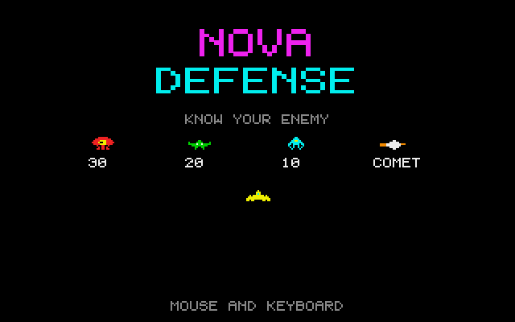
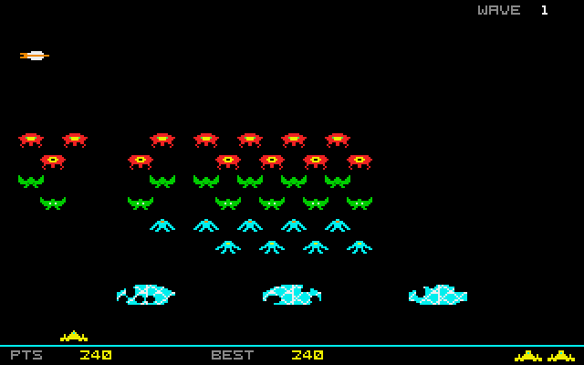

# Nova Defense: Atari ST port

Port of Nova Defense, the fixed-screen alien shooter in
[geekychris/amiga_games](https://github.com/geekychris/amiga_games) (`nova_defense/`,
commit in `.upstream-commit`), built on the shared ST layer in `../st_port`.

## Screenshots

<table><tr>
<td align="center"><br>Title</td>
<td align="center"><br>Wave 1, shields eroding</td>
<td align="center"><br>The comet</td>
</tr></table>

Captured through the agent API (`/screen`, 2x) while `bot.py` played.

```sh
make CROSS=~/computers/atari-cc/opt/cross-mint/bin/m68k-atari-mintelf-
make run CROSS=...           # ST, PAL EmuTOS, autostart
python3 bot.py --seconds 60  # watch a bot play it through the agent API
```

Controls: mouse, cursor keys / A,D or joystick to move. Left button, Space,
Alt or fire to shoot. Esc quits.

## Changes from the Amiga version

| | |
|---|---|
| `game.c` | Unchanged (the 3DO version's: 48 aliens in six staggered rows, crystal shields, the comet), except `ALIEN_CELL_W` (24 instead of 26, in `game.h`, so a row's sprites share one pre-shift) and one **performance fix worth upstreaming**: when aliens reach the shields, the original tested every shield pixel against every alien (~77,000 loop iterations per frame). On an 8 MHz 68000 that froze the game for ~2 s. It now clears each alien's overlap with each shield: same result, ~100x cheaper. Found with the agent API: `/debug/break` → backtrace `game_update+0x4d8` → `addr2line`. |
| `draw.c` | `draw_game()` (clear + redraw everything) split into a diffed HUD layer (scaled 5x7 text cached per string, shields cached by pixel checksum, reserve ships, the bottom bar) and a sprite layer. The aliens are two-colour character art turned into bit-plane masks: `gfx_or16_row_planes()` ORs a whole row of them in one go, with masks pre-shifted for the two x phases a 24 px spaced row has and only the non-empty rows of each plane. Their colour pairs are picked so each pair needs two or three planes (the 3DO's magenta/yellow, green/white and light blue/orange are red/yellow, green/white and cyan/yellow here), and the swarm flaps in step. The player and the comet are 16 pixel masks (`gfx_mask16()`). |
| input | Mouse (x movement, left button), keyboard and joystick through `st_ikbd` (IKBD 0x14 + 0x08: mouse and joystick together). |
| sound | Paula waveforms → YM2149 at the same pitches (Paula period P with 32-sample waves = YM period P x 1.128): the swarm's three rising blips, melody, shots, the comet's rising whoosh, explosions. |
| main | Layered frame loop. HUD layer skipped entirely when score/lives/shields haven't changed. 50 Hz game updates, display paced to at most 25 fps. NatFeats `NOVA` log lines and symbols. |

Performance: about 20 fps (2.3–2.6 VBLs a frame while `bot.py` plays) on a
plain 8 MHz ST, as before the redesign; game logic runs at the original
50 Hz.
