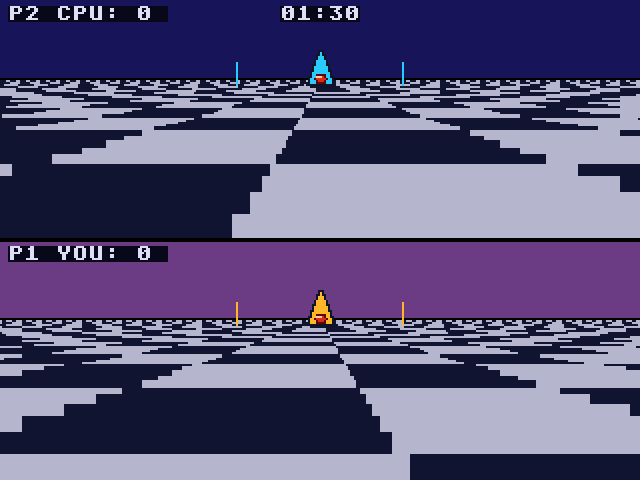
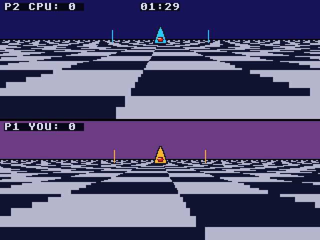
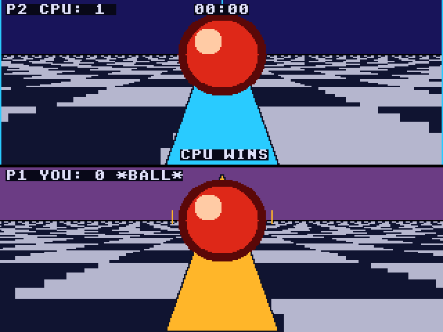

# Rotoball: Atari Falcon030 port

Port of Rotoball, the split-screen futuristic ball sport from
[geekychris/amiga_games](https://github.com/geekychris/amiga_games)
(`rotoball/`, commit in `.upstream-commit`). You and the computer each pilot
a hovering skimmer over a chequered pitch: grab the ball and carry it over
the other goal line before the 90 seconds run out. The top half of the
screen is the computer's view, the bottom half yours. Goals score 1, 2 or 3
points depending on how far out you started your run.

On the Amiga it is a 32-colour (5 bitplane) OCS/ECS game that draws its
floor straight into the bitplanes. It uses 16 of the colours, so an STE's
16 would have done, but the whole picture is redrawn every frame (two
perspective floors, plus the sky, skimmers and ball), which a 68000 at
8 MHz can't keep up with. The port runs on the Falcon layer in
[../falcon_port](../falcon_port) (320x240, 16-bit true colour).

## Screenshots

<table><tr>
<td align="center"><br>Kick-off</td>
<td align="center"><br>Driving up the pitch</td>
</tr><tr>
<td align="center"><br>Full time</td>
<td></td>
</tr></table>

Captured through the agent API (`/screen`, 2x) by `rotoball_test.py`.

```sh
make CROSS=~/computers/atari-cc/opt/cross-mint/bin/m68k-atari-mintelf-
make run CROSS=...      # Falcon030, 14 MB, VGA, EmuTOS 1024k, autostart
```

Controls, as on the Amiga:
- W / S: forward / back (towards the computer's goal and away from it).
- A / D: strafe left / right.
- Esc: quit.
- Port addition: the cursor keys and the joystick do the same as W/A/S/D.

The match starts at once and there is no title screen, as on the Amiga.
Goals and ball pick-ups play the game's synthesised clang and ping samples
on the Falcon's DMA sound.

## What changed

| | |
|---|---|
| `rotoball.h`, `sound.h` | **Unmodified.** |
| `main.c` | `__MINT__` branches: the screen is fgfx's (triple buffered) instead of an Amiga screen with two `ScreenBuffer`s and a backdrop window; IKBD keys and joystick instead of IDCMP raw keys; the VBL counter instead of `WaitTOF`; no `OpenLibrary`. The game logic and the computer player are unchanged. It also logs score changes, the end of the match and a PERF line (see below). |
| `pitch.c` | `__MINT__` branch of `draw_checker_floor`, which on the Amiga writes the floor straight into the 5 bitplanes (see below). Everything else in the renderer (sky, goal posts, skimmers, ball) is unchanged and draws through fgfx's graphics.library calls. Two `if (..) ..; if (..) ..;` lines are split in two, for GCC 14's `-Wmisleading-indentation`. |
| `sound.c` | `__MINT__` branch: no audio.device. The same one-shot samples play on channel 0 of the Paula emulation (`../st_port/paula`), as in the 3DO port. |

The floor: per row, the Amiga version works out each pixel's pitch z
coordinate with a division per pixel, then its cell with another. The port
tables the per-row quotient once (only the camera's z offset and facing
change it), and with it the first pixel at which each value is reached. The
cell then changes exactly where that value crosses a cell boundary, so each
row is filled as runs of alternating colour, one table lookup per cell
instead of two divisions per pixel. The pixels are the same: checked against
the per-pixel formula for every camera z, both directions and every row.

The game keeps its 320x256 coordinates; Y is mapped to 240 lines (each
128-line pane shows 120).

Timing: the Amiga runs one game tick per drawn frame, with no fixed rate,
while the match clock counts 25 ticks a second (`MATCH_FRAMES = 90 * 25`).
The port runs 25 ticks a second from the VBL counter (up to 4 per drawn
frame), so the 90-second match lasts 90 seconds whatever the frame rate.
(The 3DO port runs 50 a second, where the match lasts 45 seconds.)

## Performance

On a 16 MHz Falcon030 (VGA): about 15 fps in open play, down to about 7 when
the skimmers and the ball are close to a camera and fill the panes (pixel
fills for the big triangles and the shaded ball). The game logic keeps its
25 ticks a second either way. For comparison, the Amiga floor alone costs two
divisions per pixel, over 100,000 a frame.

## Upstream notes

Found while porting, not changed here:
- The match clock assumes 25 frames a second, but the loop runs one tick
  per drawn frame (up to 50 a second with `WaitTOF`), so on a fast machine
  the match is shorter than 90 seconds.
- After full time the game keeps running: the skimmers still move and
  `check_goal()` still scores, so the score can change under the
  "YOU WIN!" / "CPU WINS" banner. There is no restart; Esc quits.
- `rotoball.h` says +Z is P1's right, but D (strafe right) moves P1 towards
  -Z, which `pitch.c` projects to the right of the screen; the comment is
  backwards, the game is consistent.
- When the skimmers stay in contact, the ball changes hands at every
  tackle-cooldown expiry (about every 2.4 s at 25 ticks a second).

## Tests and agent hooks

`rotoball_test.py` (with `make run` going, `HATARI_API` if not on :7777)
resets the emulator, checks that the match starts, that W, A, D and S move
the player's skimmer (its position read from emulated memory), plays the rest
of the match with fast-forward to the "match over" line, and quits with Esc;
the screenshots above come from it. The game logs `rotoball SYMBOL
frame_count|p1|ball 0x...`, `score=P1:P2 time=...` on every goal,
`match over score=...`, its tackles, and a PERF line every 100 frames.
