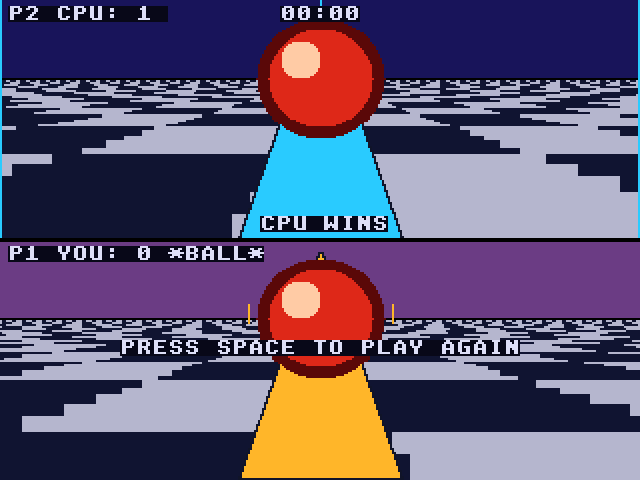
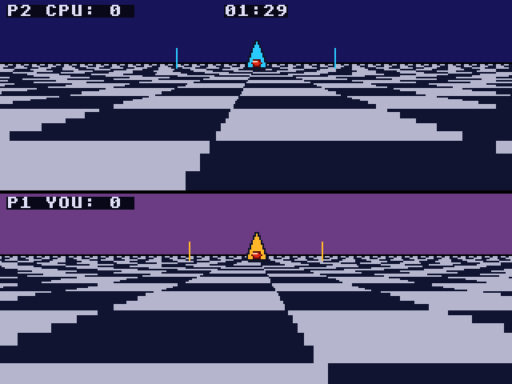

# Rotoball: Atari Falcon030 port

Port of Rotoball, the split-screen futuristic ball sport from
[geekychris/amiga_games](https://github.com/geekychris/amiga_games)
(`rotoball/`, commit in `.upstream-commit`). You and the computer each pilot
a hovering skimmer over a chequered pitch: grab the ball and carry it over
the other goal line before the 90 seconds run out. The top half of the
screen is the computer's view, the bottom half yours. Goals score 1, 2 or 3
points depending on how far out you started your run.

On the Amiga it is a 32-colour (5 bitplane) OCS/ECS game that draws its
floor straight into the bitplanes. It uses 16 of the colours, so an STE's
16 would have done, but the whole picture is redrawn every frame (two
perspective floors, plus the sky, skimmers and ball), which a 68000 at
8 MHz can't keep up with. The port runs on the Falcon layer in
[../falcon_port](../falcon_port) (320x240, 16-bit true colour).

## Screenshots

<table><tr>
<td align="center"><br>The kick-off screen</td>
<td align="center"><br>Driving up the pitch</td>
</tr><tr>
<td align="center"><br>Full time</td>
<td align="center"><br>The next match</td>
</tr></table>

Captured through the agent API (`/screen`, 2x) by `rotoball_test.py`.

```sh
make CROSS=~/computers/atari-cc/opt/cross-mint/bin/m68k-atari-mintelf-
make run CROSS=...      # Falcon030, 14 MB, VGA, EmuTOS 1024k, autostart
```

Controls, as on the Amiga:
- W / S: forward / back (towards the computer's goal and away from it).
- A / D: strafe left / right.
- Space: start the match on the kick-off screen; play again after full time.
- Esc: quit.
- Port addition: the cursor keys and the joystick do the same as W/A/S/D,
  and fire the same as Space.

The game opens on a kick-off screen (pitch frozen, title, controls). At
full time play freezes under the result and Space starts the next match.
Goals and ball pick-ups play the game's synthesised clang and ping samples
on the Falcon's DMA sound.

## What changed

| | |
|---|---|
| `rotoball.h`, `sound.h` | **Unmodified.** |
| `main.c` | `__MINT__` branches: the screen is fgfx's (triple buffered) instead of an Amiga screen with two `ScreenBuffer`s and a backdrop window; IKBD keys and joystick instead of IDCMP raw keys; the VBL counter instead of `WaitTOF` and `CurrentTime()`; no `OpenLibrary`. The game logic and the computer player are the Amiga's. It also logs score changes, SYMBOL addresses and a PERF line (see below). |
| `pitch.c` | `__MINT__` branch of `draw_checker_floor`, which on the Amiga writes the floor straight into the 5 bitplanes (see below). Everything else in the renderer (sky, goal posts, skimmers, ball) is the Amiga's and draws through fgfx's graphics.library calls. |
| `sound.c` | `__MINT__` branch: no audio.device. The same one-shot samples play on channel 0 of the Paula emulation (`../st_port/paula`), as in the 3DO port. |

The floor: per row, the Amiga version works out each pixel's pitch z
coordinate with a division per pixel, then its cell with another. The port
tables the per-row quotient once (only the camera's z offset and facing
change it), and with it the first pixel at which each value is reached. The
cell then changes exactly where that value crosses a cell boundary, so each
row is filled as runs of alternating colour, one table lookup per cell
instead of two divisions per pixel. The pixels are the same: checked against
the per-pixel formula for every camera z, both directions and every row.

The game keeps its 320x256 coordinates; Y is mapped to 240 lines (each
128-line pane shows 120).

Timing: the Amiga runs one game tick per drawn frame, up to 50 a second
(`WaitTOF`), and its match clock counts real time in 1/50 s units. The port
runs 50 ticks a second from the VBL counter (up to 8 per drawn frame), so
the game plays at the Amiga's 50 fps speed and one tick is one clock unit:
the 90-second match lasts 90 seconds whatever the frame rate.

## Performance

On a 16 MHz Falcon030 (VGA): about 14 fps in open play, down to about 7 when
the skimmers and the ball are close to a camera and fill the panes (pixel
fills for the big triangles and the shaded ball). The game logic keeps its
50 ticks a second either way. For comparison, the Amiga floor alone costs two
divisions per pixel, over 100,000 a frame.

## Fixes to the original (October 2026)

Made in amiga_games and carried into this port and the 3DO one:
- **Match clock**: it counted drawn frames at an assumed 25 a second, so a
  50 fps machine finished the "90 seconds" in 45. It now counts real time.
- **Full time**: the skimmers kept moving and goals kept counting under the
  result banner; play now freezes.
- **Start / restart**: a kick-off screen at launch, Space starts; Space
  plays again after full time (there was no way to before).
- **Tackles**: two skimmers that stayed in contact passed the ball back and
  forth at every tackle-cooldown expiry. A tackle now also locks the ball to
  its new holder until the skimmers have separated: to win it back you have
  to come in again.
- The backwards +Z comment in `rotoball.h`, and the
  `-Wmisleading-indentation` lines.

## Tests and agent hooks

`rotoball_test.py` (with `make run` going, `HATARI_API` if not on :7777)
resets the emulator and checks: the kick-off screen, with play frozen; Space
starts; W, A, D and S move the player's skimmer (its position read from
emulated memory); the rest of the match, fast-forwarded, lasts 90 emulated
seconds (counted in VBLs); play is frozen at full time; Space starts the
next match; Esc quits. The screenshots above come from it. The game logs
`rotoball SYMBOL frame_count|p1|ball|match_state 0x...`,
`state=KICKOFF|PLAYING|FULLTIME`, `score=P1:P2 time=...` on every goal, its
tackles, and a PERF line every 100 frames.
