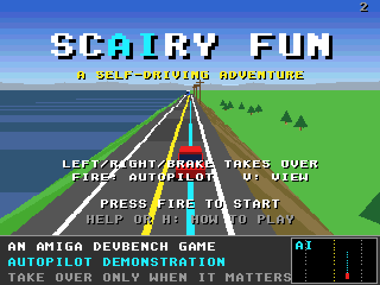

# ScAIry Fun (Falcon030)

The Atari Falcon030 port of [ScAIry Fun](https://github.com/geekychris/amiga_games/tree/main/scairy_fun), an Amiga game on
the shared amiga3d engine. You ride in a car that drives itself. Points come from the distance it drives on autopilot, multiplied by how long it has stayed on; the autopilot has blind spots, so take the wheel just before it gets something wrong, then hand it back. Four routes, music and voice.

It runs on the Falcon through [`../a3d_falcon`](../a3d_falcon/README.md),
the engine's Falcon platform layer: the game's own sources are copied from
amiga_games and built for the Falcon as they are.




## On the Falcon

- **Machine:** a Falcon030 with a 68060 accelerator (CT60 class; Hatari
  `--cpulevel 6 --cpuclock 32 --addr24 off --ttram 64`, as `../games.ini`
  starts it) runs it at the Amiga versions' 25 frames a second.
  On a stock 16 MHz Falcon it draws about 3 frames a second; the game keeps time but is jerky. Full speed needs the accelerator.
  The same program runs on both: it is 68020-68060 code, and the
  fixed-point multiply and divide use the 68030's 64-bit instructions
  when the CPU has them.
- **Screen:** 320 x 240 in 256 colours (VGA): the game's 32 pens plus 16
  for the sky gradient the Amiga made with the copper. The game draws on
  320 x 256 as on the Amiga; one row in 16 is dropped (text keeps all its
  strokes).
- **Sound:** the effects and the music on the Falcon's DMA sound through the
  repository's Paula emulation and C ProTracker player (`../st_port`).
  The program loads `DATA\SCAIRY.MOD` and `DATA\SCAIRY.VOC` from its folder (the Makefile copies scairy.mod, scairy.voc there under GEMDOS 8.3 names); without them the game plays with its effects only.
- **Changes to the game's code:**
  - `render.c`: the HUD cache has a slot for each of the Falcon's three screen buffers (was 2).

## Controls

| | |
|---|---|
| Left / right | steer (takes over) |
| Down | brake (takes over) |
| Up | accelerate (manual) |
| Space / fire / Alt | autopilot on / off (near a lane centre) |
| V / C | chase / cockpit view |
| Return / F1 | start |
| P | pause |
| Help / H | the rules |
| Esc | back to the title, or quit from it |

On the ST keyboard the Amiga's keys map to the same places (`../a3d_falcon/main_falcon.c`).

## Building and running

```sh
make CROSS=~/computers/atari-cc/opt/cross-mint/bin/m68k-atari-mintelf-
                             # build/SCAIRY.PRG and build/DATA/
make run                     # Hatari (agent API), build/ as C:, autostart
make run HATARI_OPTS="--cpulevel 6 --cpuclock 32 --addr24 off --ttram 64"   # with a 68060
make test                    # the tests on the Falcon in Hatari (build/obj/test/SCTEST.PRG)
make host-test               # the same tests built for this machine
make trace                   # tests/trace_main.c in Hatari, diffed with the host build's output
```

`../a3d_falcon/tools/a3d_agent.py` drives a running game through the
agent API (`cmd 'hook autoplay on'`, `cmd vars`, `shot`, `key`, `perf`),
and `a3d_e2e.py scairy_fun --shots` is the end-to-end check below.

## Tested

- `make test`: 90 passed, 0 failed, on the 68030 and on the
  68060 (the same as `make host-test`), including the rules, the world and the autopilot; and `make trace`: route 1 driven by the perfect autopilot, every event and the car every 250 frames, 21 lines identical to the host's.
- `a3d_e2e.py`: in Hatari, every key above reaches the game (the IKBD,
  the ST to Amiga key map and the game's own), the start key leaves the
  title and Esc returns to it, and the autopilot plays (`docs/play.png` on a stock Falcon, `docs/play_060.png` on a 68060).
- Frames a second with the autopilot playing: 2.9-3.0 on a stock
  16 MHz Falcon030, 25 (the cap) with a 68060 at 32 MHz.
