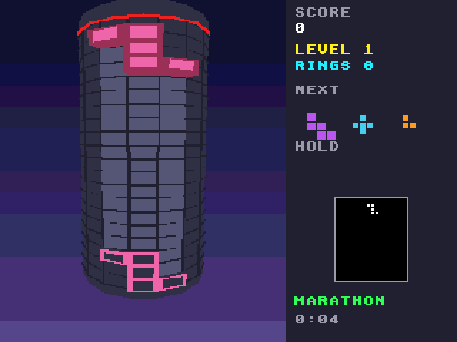

# Stack Tower (Falcon030)

The Atari Falcon030 port of [Stack Tower](https://github.com/geekychris/amiga_games/tree/main/stack_tower), an Amiga game on
the shared amiga3d engine. The falling-block puzzle wrapped round a tower: the well is sixteen columns that go all the way round, so a ring only clears when the back of the tower is full too. Moving a piece turns the tower. Marathon, Rising and Dig modes, with a demo game behind the title.

It runs on the Falcon through [`../a3d_falcon`](../a3d_falcon/README.md),
the engine's Falcon platform layer: the game's own sources are copied from
amiga_games and built for the Falcon as they are.




## On the Falcon

- **Machine:** a Falcon030 with a 68060 accelerator (CT60 class; Hatari
  `--cpulevel 6 --cpuclock 32 --addr24 off --ttram 64`, as `../games.ini`
  starts it) runs it at the Amiga versions' 25 frames a second.
  On a stock 16 MHz Falcon it draws about 3 frames a second (the tower is a cylinder of many faces): playable, the game itself keeps time, but jerky. Full speed needs the accelerator.
  The same program runs on both: it is 68020-68060 code, and the
  fixed-point multiply and divide use the 68030's 64-bit instructions
  when the CPU has them.
- **Screen:** 320 x 240 in 256 colours (VGA): the game's 32 pens plus 16
  for the sky gradient the Amiga made with the copper. The game draws on
  320 x 256 as on the Amiga; one row in 16 is dropped (text keeps all its
  strokes).
- **Sound:** the effects and the music on the Falcon's DMA sound through the
  repository's Paula emulation and C ProTracker player (`../st_port`).
  The program loads `DATA\STACK_TO.MOD` from its folder (the Makefile copies stack_tower.mod there under GEMDOS 8.3 names); without it the game plays with its effects only.
- **Changes to the game's code:**
  None: the game's sources are the amiga_games originals, unchanged.

## Controls

| | |
|---|---|
| Left / right (A / D, joystick) | turn the tower |
| Up / X | rotate clockwise |
| Z | rotate anticlockwise |
| Down | soft drop |
| Space / fire | hard drop |
| C / left Shift | hold |
| G | ghost on / off |
| P | pause |
| Help / H | the rules and controls |
| Esc | back to the title, or quit from it |

On the ST keyboard the Amiga's keys map to the same places (`../a3d_falcon/main_falcon.c`).

## Building and running

```sh
make CROSS=~/computers/atari-cc/opt/cross-mint/bin/m68k-atari-mintelf-
                             # build/STACKTWR.PRG and build/DATA/
make run                     # Hatari (agent API), build/ as C:, autostart
make run HATARI_OPTS="--cpulevel 6 --cpuclock 32 --addr24 off --ttram 64"   # with a 68060
make test                    # the tests on the Falcon in Hatari (build/obj/test/STTEST.PRG)
make host-test               # the same tests built for this machine
```

`../a3d_falcon/tools/a3d_agent.py` drives a running game through the
agent API (`cmd 'hook autoplay on'`, `cmd vars`, `shot`, `key`, `perf`),
and `a3d_e2e.py stack_tower --shots` is the end-to-end check below.

## Tested

- `make test`: 45 passed, 0 failed, on the 68030 and on the
  68060 (the same as `make host-test`), including four games from the browser's own engine: pieces, score, lines, the board's hash, the queue and the held piece (tests/vectors.h).
- `a3d_e2e.py`: in Hatari, every key above reaches the game (the IKBD,
  the ST to Amiga key map and the game's own), the start key leaves the
  title and Esc returns to it, and the title's demo game plays itself (`docs/title.png`), and a game started from the title runs (`docs/play.png` on a stock Falcon, `docs/play_060.png` on a 68060).
- Frames a second with the autopilot playing: 3.0 on a stock
  16 MHz Falcon030, 25 (the cap) with a 68060 at 32 MHz.
