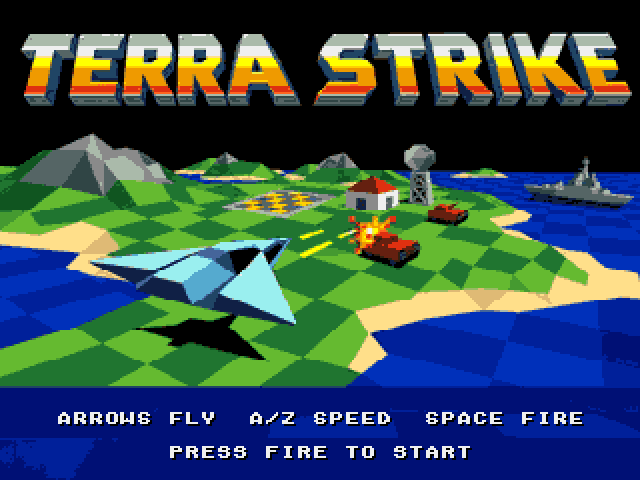
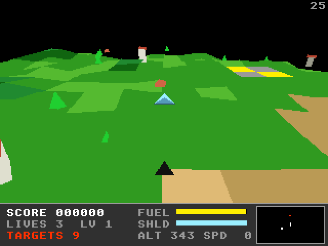

# Terra Strike (Falcon030)

The Atari Falcon030 port of [Terra Strike](https://github.com/geekychris/amiga_games/tree/main/terra_strike),
a Zarch / Carrier Command style landscape shooter: lift off from the landing
pad, fly over a wrapping fractal island and destroy the tanks, buildings and
ships. Tanks and ships shoot back. Land on the pad again to refuel and
repair; clear every target to reach the next level.




## On the Falcon

- **Machine:** a Falcon030 with a 68060 accelerator (CT60 class; Hatari
  `--cpulevel 6 --cpuclock 32 --addr24 off --ttram 64`, as `../games.ini`
  starts it) runs it at the Amiga's 25 frames a second. A stock 16 MHz
  Falcon draws about 5 frames a second: the simulation keeps time (25 steps
  a second whatever the frame rate), so it plays, but jerkily. Most of a
  frame is the game's own transforms and clipping (about 40%) and the fill.
  One program runs on both (68020-68060 code).
- **The game's own engine.** Unlike the amiga3d games, Terra Strike has its
  own terrain, renderer and simulation; they are the Amiga sources, built
  for the Falcon as they are, except `render.c`: next to its classic Amiga
  and AmigaOS 4 drawing primitives it has a third set for the Falcon
  (`TS_FALCON`), and `flush()` fills the polygons with
  [`../a3d_falcon`](../a3d_falcon/README.md)'s assembly scan conversion and
  fill. Everything else comes from the machine layer the amiga3d ports use
  (`../a3d_falcon/falcon_sys.c`): the 256-colour 320 x 240 VGA screen (the
  game's 256 rows mapped to it), the palette, the IKBD keys as the Amiga raw
  keys `game.c` maps, joystick 1, the timers, and the bridge calls
  (NatFeats logging; variables and hooks through a mailbox the agent API
  reaches). `compat/` has the few Amiga headers the sources include.
- **Screen:** double buffered (the HUD caches text per buffer, for two). The
  title artwork (`title_image.c`, five Amiga bitplanes) is converted to the
  Falcon's interleaved planes once at start-up.
- **Sound:** the music (`DATA\TERRA_ST.MOD`, copied by the Makefile from
  `terra_strike.mod`) and the synthesised effects through ptplayer on the
  Paula emulation (`../st_port`), as on the Amiga.

## Controls

| Key | |
|---|---|
| Arrows / joystick | turn, climb / dive (the craft hovers when you let go) |
| A / Z | throttle up / down |
| Space / Alt / fire | cannon (aims itself at a target within ~22° of the nose) |
| P | pause |
| Return / F1 | start |
| Esc | title / quit |

## Building and running

```sh
make CROSS=~/computers/atari-cc/opt/cross-mint/bin/m68k-atari-mintelf-
                             # build/TERRA.PRG and build/DATA/TERRA_ST.MOD
make run                     # Hatari (agent API), build/ as C:, autostart
make run HATARI_OPTS="--cpulevel 6 --cpuclock 32 --addr24 off --ttram 64"   # with a 68060
make test                    # the unit tests on the Falcon in Hatari
make trace                   # a scripted game on the Falcon, diffed with the host's
make host-test               # the unit tests built for this machine
```

`../a3d_falcon/tools/a3d_agent.py` drives the running game through the
agent API (`cmd 'hook scene tanks'`, `cmd vars`, `shot`, `key`, `perf`), and
`../a3d_falcon/tools/a3d_e2e.py terra_strike --shots` is the check below.

## Tested

- `make test`: 67 passed, 0 failed, on the 68030 and on the 68060 (the same
  as `make host-test`).
- `make trace` (`tests/trace_main.c`, added for the port): a scripted
  8000-frame game (lift off, turns, throttle, firing all the way; 1304
  events), printed every 100 frames and at every event: the Falcon's 1386
  lines are identical to the host build's on the 68030 and on the 68060.
- `a3d_e2e.py`: in Hatari every key above reaches the game (the IKBD, the ST
  to Amiga key map and `game.c`'s), the start key leaves the title and Esc
  returns to it, up lifts the craft off the pad, held fire destroys a tank
  in the "tanks" scene (`KILL tank +100`), and the music plays (captured from the DMA sound on the title).
- Frames a second over the island: 4.9 on a stock 16 MHz Falcon030
  (`docs/play.png`), 25 (the cap) with a 68060 at 32 MHz
  (`docs/play_060.png`).
