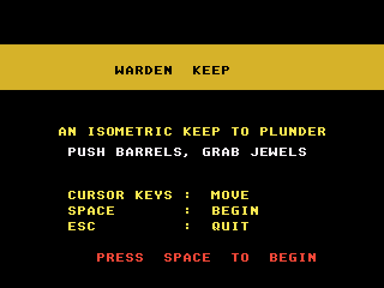
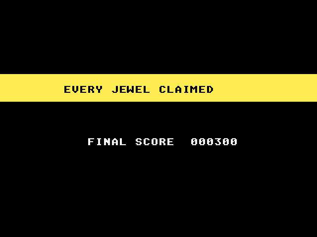

# Warden Keep: Atari Falcon030 port

Port of Warden Keep, the isometric room adventure from
[geekychris/amiga_games](https://github.com/geekychris/amiga_games)
(`warden_keep/`, commit in `.upstream-commit`): one Filmation-style room of
stone blocks, barrels you can push and three jewels to collect. On the Amiga
it uses an 8-colour screen; the port runs on the Falcon layer in
[../falcon_port](../falcon_port) (16-bit true colour), like the AGA games.

## Screenshots

<table><tr>
<td align="center"><br>Title</td>
<td align="center"><br>In the keep</td>
</tr><tr>
<td align="center"><br>Every jewel claimed</td>
<td></td>
</tr></table>

Captured through the agent API (`/screen`, 2x) by `warden_test.py`.

```sh
make CROSS=~/computers/atari-cc/opt/cross-mint/bin/m68k-atari-mintelf-
make run CROSS=...      # Falcon030, 14 MB, VGA, EmuTOS 1024k, autostart
```

Controls, as on the Amiga:
- Cursor keys, WASD, IJKL, keypad 8/4/6/2 or joystick: step one tile. Held
  keys repeat.
- Space, Return, Enter or fire: start, and back to the title from the end
  screen.
- Esc: quit.

No sound, as on the Amiga.

## What changed

| | |
|---|---|
| `game.cpp`, `game.h`, `render.h` | **Unmodified.** |
| `render.cpp` | `__MINT__` branches: the screen is fgfx's (320x240, triple buffered) instead of an Amiga screen with two `ScreenBuffer`s. The drawing code is the original's, except that the cubes' one-pixel-wide vertical `RectFill`s and the floor diamonds' one-row `RectFill`s write their words directly (same pixels). The game keeps its 320x256 coordinates; Y is mapped to 240 lines. |
| `main_falcon.cpp` | Replaces `main.cpp` (kept as `main.cpp.amiga`): IKBD keys and joystick instead of IDCMP raw keys, the VBL counter instead of `WaitTOF`, NatFeats logging. The auto-repeat logic is copied unchanged. |

Speed: the game is turn-based, so nothing changes between steps. Each of the
three screen buffers remembers which room state it shows and is only redrawn
when that changed; when another buffer already shows the new state, it is
copied from there instead. On a 16 MHz Falcon a held key then repeats a
little slower than on the Amiga (measured: every 9-14 VBLs instead of 7,
first repeat after 18 instead of 14): a redraw takes a few VBLs.

Timing: the Amiga runs one tick per 50 Hz frame (the auto-repeat counts these
ticks). The port runs the ticks due at 50 Hz from the VBL counter, and key
presses shorter than a drawn frame are not lost (`ikbd_key_hit`).

### Fix to the original

The title (`WARDEN  KEEP`) and end-screen captions are drawn in pen 0 over a
coloured bar. With the Amiga's default JAM2 draw mode (background pen 0) they
come out as black boxes (see the Amiga screenshot in amiga_games); the port
draws text in JAM1, so they can be read.

## Performance

On a 16 MHz Falcon030 (VGA): about 30 fps on the title screen (redrawn every
frame for the blinking prompt); in the room the screen only changes when you
step, see above.

## Tests and agent hooks

`warden_test.py` (with `make run` going, `HATARI_API` if not on :7777) resets
the emulator, starts a game, walks over the three jewels, checks for
`state=WIN` and quits with Esc; the screenshots above come from it. The game
logs `WARDEN SYMBOL state 0x...` (the `GameState`), `state=...` on every change
of mode or jewel count, `player wx=.. wy=..` after each step, and a PERF line
every 100 frames.
